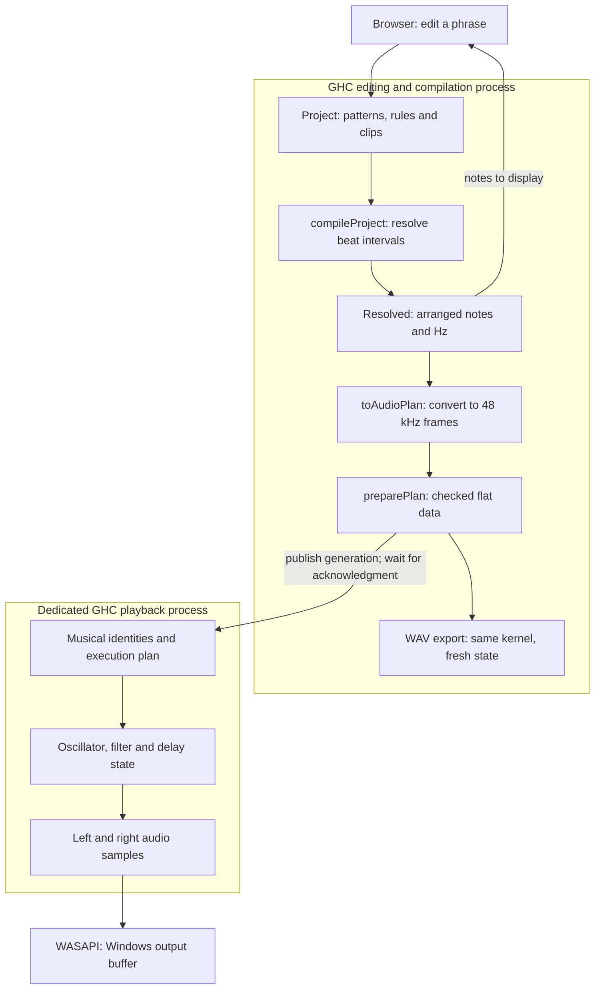

# How Aya works: follow a phrase from an edit to the next sound

Make a four-beat phrase in Aya, then move one of its notes later. The note moves on screen, and its next onset changes. If playback is running, the engine must also decide how to finish the old onset and what to do with the echo already in flight. Exporting the song to WAV must interpret the same edited phrase again.

This guide follows that edit through the code. Aya keeps an editable score as Haskell values, expands musical rules into concrete notes, and computes audio samples in a separate native GHC process. You can follow the inputs and results before learning the Haskell or DSP terminology behind each stage.

## 1. The editable phrase, resolved notes and sound have different jobs

A phrase can retain a rule such as “divide these four beats into eight steps and move through this scale.” Two clips can refer to the same phrase, so editing the phrase changes both appearances. When you want to alter individual generated notes, materialization copies the result into ordinary editable notes.

The implementation separates the editable `Project`, the expanded `Resolved` music and the sample-oriented `AudioPlan`. The notes sent back to the editor and the notes sent toward playback come from the same `Compilation`. The browser does not run an independent generator that merely resembles the Haskell result. WAV export uses the same audio kernel, starting from fresh state.



Start with [Project.hs](https://github.com/M-simplifier/aya-daw/blob/main/src/Aya/Project.hs), follow musical expansion in [Compile.hs](https://github.com/M-simplifier/aya-daw/blob/main/src/Aya/Compile.hs), then read the audio boundary in [EnginePlan.hs](https://github.com/M-simplifier/aya-daw/blob/main/src/Aya/EnginePlan.hs).

## 2. Rules as values connect editing with validation

A `Pattern` contains its length, notes, optional generator and ordered transformations. A `Clip` places a pattern on a track. A `Track` owns the instrument and mix settings. Separating the contents of a phrase from its placement makes shared patterns and clip-specific transposition distinct operations.

These declarations are excerpts from the implementation:

```haskell
data GeneratorKind = Euclid | Arpeggio | Chords
data TransformKind = Transpose | Rotate | Reverse | Stretch | Invert | Probability

compileProject :: Project -> Either [DomainError] Compilation
```

The first two lines enumerate the available kinds of rule. The last says that compiling a project returns either a list of problems or an accepted compilation. A clip pointing to a missing pattern, for example, produces a `DomainError` with a location and reason. Raw `Project` records are not automatically valid just because they have Haskell types. The constructor of an accepted `Compilation` is hidden, separating submitted data from an admitted result.

`compileProject` reads neither an audio device nor a clock. It is a pure function: the same project value produces the same result. You can test it with a score and expected notes without opening a window or speaker. Playback timing and mutable storage belong to the later audio boundary.

Generators distribute Euclidean pulses, walk scale degrees as an arpeggio, or produce a three-voice chord progression. Transformations then run in their specified order. That order matters: stretching a phrase and then rotating it by one beat generally differs from rotating it by one beat and then stretching it.

Probability-based thinning is reproducible. `randomUnit` derives its selection value from a note ID and seed, rather than drawing again whenever the project is compiled. The same ID and seed produce the same choice. Repeating a pattern in several clips does not, by itself, request a fresh random choice for every repetition. You can compare changes to the seed or probability while retaining a reproducible rule.

Materialization is implemented by `materialize`: compile the pattern, copy the resolved notes back into it, remove the generator and transformations, and compile again. The [model tests](https://github.com/M-simplifier/aya-daw/blob/main/tests/model/Main.hs) check that this operation preserves the resolved musical result.

## 3. Transform the interval a note occupies, not just its onset

Number the start of a four-beat pattern as beat 0. Consider a note beginning one beat later and lasting half a beat. Write its interval as `[1, 1.5)`: it includes its start and excludes its end. An adjacent note may begin at 1.5 without making the boundary ambiguous.

Reversal reflects both ends of that interval:

| Operation | Original | Result |
|---|---|---|
| Reverse within four beats | `[1, 1.5)` | `[2.5, 3)` |
| Rotate by 0.25 beats | `[3.5, 4)` | `[3.75, 4)` and `[0, 0.25)` |
| Stretch by two | `[1, 1.5)`, period 4 | `[2, 3)`, period 8 |

The reversed onset is `L - start - duration`. Using only `L - start` would ignore how long the note sounds. The actual branch reads directly as that rule:

```haskell
Reverse -> mapNotes (\n -> n { noteStart = lengthBeats - noteStart n - noteDuration n })
```

Rotation wraps the portion crossing the cycle boundary to the beginning and creates two distinct note fragments. Their IDs remain distinguishable. This is interval wrapping, not a tie joining two onsets into one uninterrupted voice. Stretching changes the pattern's period along with every onset and duration, so repeated clips inherit the new spacing.

Beat calculations use `Beat Rational`, a fraction of integers. A beat divided into thirds is not repeatedly rounded to sample counts during musical transformations. At 120 BPM and 48 kHz, `1/3` beat becomes exactly 8,000 frames and `2/3` becomes 16,000. At the audio boundary, `beatFrame` rounds the onset and end once; `toAudioPlan` takes their difference for the duration.

Rational time preserves relationships during those beat calculations. It does not make JSON's decimal presentation, frequency conversion or DSP infinitely precise. Nor is arbitrary exact-rational recovery from saved decimal values guaranteed. Standard save/reopen fixtures separately check sample positions and rendered output.

## 4. Microtonality and voice leading become concrete calculations

Note pitch uses a continuous coordinate measured in MIDI semitones: 69 denotes the reference A4, while 69.5 is also a valid pitch. One step of 19 equal divisions of the octave is `12/19` of a semitone in that coordinate. With A4 at 440 Hz:

| 19-EDO position | Pitch coordinate | Frequency |
|---|---:|---:|
| Reference | 69 | 440 Hz |
| One step higher | `69 + 12/19` | About 456.3482 Hz |
| One octave higher | 81 | 880 Hz |

`degreePitch` maps the chosen scale's steps into this coordinate. `frequencyFor` then computes `referenceHz × 2^((pitch - 69)/12)`. There is no rounding to an integer MIDI note on this path. If the scale selects `[0,3,5,8,11,13,16]` from 19-EDO, moving to the next scale degree is different from moving up one 19-EDO step. The selected scale and the equal division have separate meanings.

Chord generation separates the chord's scale degrees from its register. `voiceLeading` starts with degrees 0, 2 and 4 relative to each progression degree. Assigning each of the three notes an octave displacement of −1, 0 or +1 gives at most 27 candidates before deduplication and filtering. Candidates are compared as low, middle and high voices.

The cost combines the sum of each voice's movement with a small preference for a central register. Dynamic programming carries the best previous cost into each next candidate. It chooses across the supplied progression, rather than making an isolated greedy choice at each chord. Its result is the least-cost path within these finite candidate sets and this particular cost model. It is not a general counterpoint engine or a universal measure of good music.

Logarithmic pitch, reflected intervals and distances between voicings turn specific musical questions into executable calculations. A composer still decides which transformations and notions of closeness are useful. The equations make those choices visible and changeable rather than disguising them as an automatic aesthetic judgment.

## 5. Array and relational thinking are ways to organize the work

Lay out chord candidates as “chord position × candidate × three voices,” and the comparisons become easier to see. Distinguish “voice × stereo channel × time” in audio, and summing independent voices becomes a different job from advancing one voice's history. Attending to axes and shapes in this way is an APL-style perspective on the problem.

Aya does not materialize one giant tensor of the whole song. `PreparedPlan` creates contiguous note, track and asset data with indexes. `Runtime` owns bounded voice slots and delay storage. Addresses, sizes and access order are prepared so playback can read what it needs. Merely putting values into arrays would not establish automatic SIMD or parallel execution.

A relational perspective associated with Prolog suggests another separation: describe admissible candidates, then decide how to search or choose among them. Generating three-voice placements that meet register and ordering conditions differs from selecting a progression by movement cost. Checking that notes refer to existing tracks and fit the engine's capacities is another explicit admission step. The [SWI-Prolog manual](https://www.swi-prolog.org/man/clpfd.html#clpfd-search) likewise distinguishes relations from search.

Aya currently embeds neither APL nor Prolog, and has no general constraint solver or arbitrary signal-graph synthesis facility. These are useful design lenses, not runtime dependencies or claims of a general relational language. The implemented mechanisms are ordinary Haskell data, validation and finite-candidate dynamic programming. You can inspect exactly which values are arranged and which conditions select them.

## 6. A changed score does not erase a sounding note's history

Return to the edit. Raising a sounding note's pitch slightly need not reset its oscillator phase to zero. Moving the same note into the future must, however, finish its old onset. The new instruction and the sound's accumulated history are different things.

`installPlan` matches state by stable note and track identities, rather than memory addresses. A pitch-only edit retains phase, filter memories and the integrated sample position, while the frequency slews toward its new value. Moving, shortening or deleting a note compares its new interval with the current cursor to determine the remaining gate or release. Reordering tracks does not turn an existing track's delay into a new, empty effect.

For an exact instance, give the note above a frequency of 456.3482 Hz, place its pattern at the song's start and play at 120 BPM. Its original `[1, 1.5)` beats become audio frames `[24000, 36000)`; the reversed `[2.5, 3)` becomes `[60000, 72000)`. If playback is at beat 1.25, frame 30,000, the new onset is in the future. The old onset enters release, and the note starts again at frame 60,000. Note `n` in clip `c` on its first repetition has resolved identity `c/n/0`. That identity connects the old and new plans while the track retains its echo. The editor displays beat 2.5, and a fresh WAV render places the same note at frame 60,000.

Two shared-memory slots carry execution plans. The editing process writes a complete plan into the slot that playback is not reading, then publishes a generation. At an audio-buffer boundary the worker switches plans and migrates state. It acknowledges only after dropping all references to the old plan; only then may the editor reuse that old slot. Oversized projects fail before the switch rather than silently losing notes to fit.

Feedback explains why state deserves this care. A delay's next output depends on earlier values. Two processors can produce the same value now yet differ at the next sample because their phases or echoes differ. A one-sample state model can still be a function: take the current inputs and previous memory, return the output and next memory. Functional meaning does not require a sound to have no history.

The production kernel advances that memory in preallocated storage. Here is the arithmetic and commit step from `filterSample` in [Kernel.hs](https://github.com/M-simplifier/aya-daw/blob/main/audio/Aya/Audio/Kernel.hs):

`previousLow` and `previousBand` are two memories carried from the preceding sample. The cutoff frequency determines `g`; the resonance setting determines `damping`. A voice holds the phase and filter memory for one sounding note, while a track mixes several such voices.

```haskell
let band = (previousBand + g*(input-previousLow)) / (1+g*(g+damping))
    low = previousLow + g*band
writeD voice bandOffset (2*band-previousBand)
writeD voice lowOffset (2*low-previousLow)
```

You can follow the old values, the calculation and the next stored memories. [Layout.hs](https://github.com/M-simplifier/aya-daw/blob/main/audio/Aya/Audio/Layout.hs) names each voice and track field. Restricting mutable memory to the audio thread, while admitting ranges and capacities in the plan, keeps musical validation separate from low-level updates. Types alone do not prove every index or deadline.

## 7. What was checked in GHC and on a real device

In the audio process, a long-lived Haskell thread waits for a Windows buffer-ready event, calculates oscillators, envelopes, filters, mixing and delay, then returns samples to WASAPI. The browser does not synthesize the sound, and playback is not a pre-rendered WAV of the song. The C boundary handles COM, handles, shared memory and atomics; it contains no DSP sample calculations.

Inspection of an optimized GHC 9.14.1 build found primitive memory operations and unboxed values in Core, direct arithmetic, stores and branches in Cmm, and scalar SSE2 operations in the x86-64 output. Core and Cmm are intermediate forms on GHC's path to machine code. Rather than infer efficiency from functional syntax, the inspection checks whether intermediate lists or boxed sample tuples remain in the relevant loops.

Execution was checked separately. These are observations from the initial native Windows, 48 kHz, GHC 9.14.1 configuration:

| Check | Observation |
|---|---|
| Plan exchange preserving signal history | 18,000 frames actually supplied to WASAPI matched an independent reference; maximum sample error 0 |
| Whether that reference detects a fault | Deliberately clearing the delay was detected at about `2.58 × 10⁻⁶` sample error |
| 32 tracks, 256 simultaneous voices, 12 plan exchanges and 60 editor-process collections | About 7.3 seconds and 729 buffers; no observed late fills or starvation; maximum work 6.513 ms against normal 10 ms fills |
| Allocation after warmup | 32 bytes for a 4,800-frame sustained block, and 32 bytes for a 4,096-frame block with all nine families and automation |

The reference does not reuse the production delay ring or filter-state update. It advances a direct-form filter recurrence and a pure FIFO one sample at a time. The probe drives the production kernel and plan migration at a known sample boundary, then compares the buffers supplied to WASAPI. The output agrees with the reference that carries its echo through the exchange, and disagrees with a faulty reference variant that clears the delay there. The shared-memory exchange protocol is exercised by the separate load test in the table. Read [Reference.hs](https://github.com/M-simplifier/aya-daw/blob/main/audio/Aya/Audio/Reference.hs) and [Diagnostics.hs](https://github.com/M-simplifier/aya-daw/blob/main/audio/Aya/Audio/Diagnostics.hs) together.

These short runs are a concrete result, not a guarantee for every machine, device or long session. The load run's final portion included release, so not every packet held 256 sustained voices. The 32-byte figures measure net allocation in the tested blocks, not an allocation-free entry path or RTS; event and transport paths retain heap/GC checks. Process separation removes direct GC synchronization with the editor, but audio-process collection, OS scheduling and driver delays remain. This is a low-latency engine using the ordinary GHC runtime, not a hard-realtime proof. [audio-validation.md](https://github.com/M-simplifier/aya-daw/blob/main/docs/audio-validation.md) records the conditions and counter meanings.

## 8. Find a boundary to read, change and test

You do not have to start by understanding the whole application.

| Area to change | Starting points | First useful evidence |
|---|---|---|
| Patterns, pitch, generation and transformations | [Project.hs](https://github.com/M-simplifier/aya-daw/blob/main/src/Aya/Project.hs), [Compile.hs](https://github.com/M-simplifier/aya-daw/blob/main/src/Aya/Compile.hs) | Interval examples, reproducibility and materialization preservation |
| Beat/sample conversion and WAV assets | [EnginePlan.hs](https://github.com/M-simplifier/aya-daw/blob/main/src/Aya/EnginePlan.hs) | Onset/end rounding, asset admission and explicit capacity errors |
| Oscillators, filters and delay | [Kernel.hs](https://github.com/M-simplifier/aya-daw/blob/main/audio/Aya/Audio/Kernel.hs), [Reference.hs](https://github.com/M-simplifier/aya-daw/blob/main/audio/Aya/Audio/Reference.hs) | Independent expected values, block-partition equality and retained state |
| Plan exchange and Windows ownership | [Audio.hs](https://github.com/M-simplifier/aya-daw/blob/main/audio/Aya/Audio.hs), [aya_native.c](https://github.com/M-simplifier/aya-daw/blob/main/audio/cbits/aya_native.c) | Memory lifetime, acknowledgment, stop and release |

For a new beat transformation, inspect `TransformKind`, its JSON tag, `validateTransform` and `applyTransform`. Define a small input interval and its intended result first, then add a model test. Add the editing control once the musical meaning is clear. For DSP changes, begin with a short input whose expected output can be calculated independently, then check sound production, meaning and target-device timing separately.

The current native audio target is Windows. With GHC 9.14.1 and Cabal available, follow the repository's [build instructions](https://github.com/M-simplifier/aya-daw/blob/main/README.md).

A normal `cabal build` is for local development and follows the installed GHC's runtime linkage, which may include static GMP. For a redistributable Windows ZIP, use `./scripts/build.ps1 -Release -Tests`, followed by `./scripts/package.ps1 -SkipBuild`. Aya's own code is MIT; the release's GNU MP 6.3.0 is LGPL-3.0-or-later. The release path uses a replaceable `libgmp-10.dll` and includes its complete corresponding source and dependency notices. See [THIRD-PARTY.md](https://github.com/M-simplifier/aya-daw/blob/main/THIRD-PARTY.md) for the full distinction.

The central checks are:

```text
cabal test aya:model-tests aya-audio:audio-tests --test-show-details=direct
cabal run exe:aya -- --audio-self-test diagnostics
```

Device tests are explicit: lower the output volume before running `cabal run exe:aya -- --audio-device-test diagnostics`. The heavier diagnostic is `cabal test aya-audio:audio-tests --test-options="--stress" --test-show-details=direct`. Plan exchange changes data interpreted by existing kernels. It does not load arbitrary new Haskell machine code without interruption, and is not a general plug-in host.

### Primary sources for further reading

The work below provides precedents and comparisons rather than implementation dependencies.

- [Euterpea's music data types](https://github.com/Euterpea/Euterpea/blob/master/HSoM/Music.lhs) are a precedent for music as composable values. Aya represents editable patterns, their placements and resolved notes.
- [Tidal's cycles and subdivisions](https://tidalcycles.org/docs/reference/cycles/) offer a perspective on repetition and musical time. Aya expands finite patterns and clips in rational beats; it does not implement Tidal's pattern type.
- [Faust's design](https://faustdoc.grame.fr/manual/introduction/) and [mimium](https://github.com/mimium-org/mimium-rs) are important precedents for functional DSP and feedback. Aya uses fixed kernels compiled by ordinary GHC, not either system's compiler or runtime.
- [Tymoczko's geometry of musical chords](https://collaborate.princeton.edu/en/publications/the-geometry-of-musical-chords/) studies spaces and distances for chords and voice leading. Aya's three-voice finite search is not an implementation of that whole theory.
- [SWI-Prolog on relations and search](https://www.swi-prolog.org/man/clpfd.html#clpfd-search) and [Repa's shape-polymorphic arrays](https://www.microsoft.com/en-us/research/wp-content/uploads/2016/07/RArrays.pdf) help distinguish constraints from selection and axes from storage. Aya uses neither a general solver nor the Repa library.

For the filter, oscillator, GHC and WASAPI references and their concrete use, see [audio-research.md](https://github.com/M-simplifier/aya-daw/blob/main/docs/audio-research.md).
