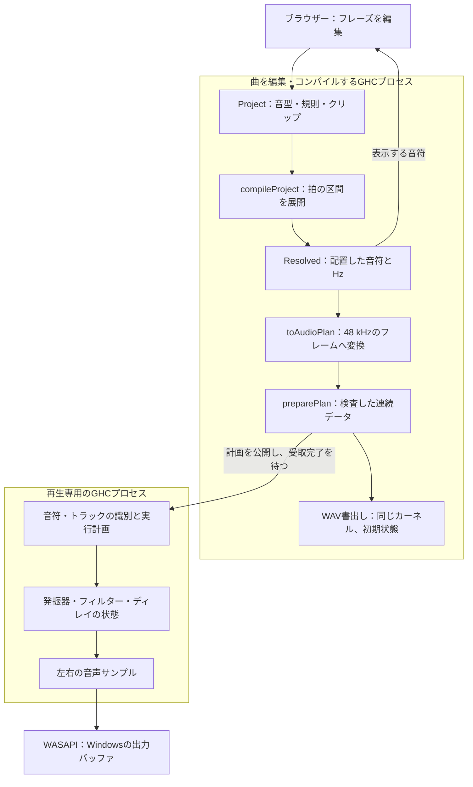

# Ayaのしくみ――一つのフレーズを編集して、音が変わるまで

Ayaで4拍のフレーズを作り、途中の音を後ろへ移してみます。画面の音符が動き、次の発音時刻が変わります。再生中なら、すでに鳴っている音をどう終え、残響をどこまで残すかも決めなければなりません。保存した曲をWAVへ書き出すときも、そのフレーズをもう一度解釈します。

このガイドでは、その一件をコードで追います。Ayaは、編集できる曲をHaskellの値として持ち、生成規則を具体的な音符へ展開し、別プロセスのGHCプログラムで音声サンプルを計算します。Haskellや音響処理を初めて読む場合も、まず何が渡され、何が返るかを見てから各部へ進めます。

## 1. フレーズ、解決した音符、音声には別の役割がある

フレーズには「8等分した拍で、この音階を上り下りする」という規則を残せます。同じフレーズを二つのクリップに置けば、一方のフレーズ編集が両方へ届きます。生成結果を直接直したくなったら「音符に確定」を使い、規則から得た音符を通常の編集対象へ変えます。

内部では、編集可能な `Project`、規則と配置を展開した `Resolved`、音声用の `AudioPlan` を分けています。画面へ返す音符と再生へ渡す音符は、同じ `Compilation` の結果です。ブラウザーが別の生成器で似たフレーズを作る構成ではありません。WAV書出しも同じ音声カーネルを使い、初期状態から曲を実行します。



入口は [Project.hs](https://github.com/M-simplifier/aya-daw/blob/main/src/Aya/Project.hs)、曲の展開は [Compile.hs](https://github.com/M-simplifier/aya-daw/blob/main/src/Aya/Compile.hs)、音声への変換は [EnginePlan.hs](https://github.com/M-simplifier/aya-daw/blob/main/src/Aya/EnginePlan.hs) にあります。

## 2. 規則を値にすると、編集と検査を同じ場所で扱える

`Pattern` は長さ、音符、任意の生成器、変形の並びを持ちます。`Clip` はその音型をどのトラックのどこへ置くかを持ちます。音色やミックスは `Track` が受け持ちます。音型の内容と、その使い方を別の値にしたため、同じ音型の再利用と、クリップだけの移調を区別できます。

実際の宣言を抜粋します。

```haskell
data GeneratorKind = Euclid | Arpeggio | Chords
data TransformKind = Transpose | Rotate | Reverse | Stretch | Invert | Probability

compileProject :: Project -> Either [DomainError] Compilation
```

最初の二つは、指定できる規則の種類です。最後の型は「曲を受け取り、問題の一覧か、コンパイルした曲を返す」と読めます。たとえば消えた音型を指すクリップや、範囲外の音高は、場所と理由を持つ `DomainError` になります。`Project` の各項目が型だけですべて正しくなるわけではありません。検査を通った `Compilation` はコンストラクターを公開せず、入力と採用済みの結果を区別しています。

`compileProject` は音声デバイスや時計を読みません。同じ曲の値を渡すと同じ結果を返す純粋関数です。画面やスピーカーを開かず、曲と期待する音符だけで検査できます。再生に必要な時刻やメモリーの更新は、後の音声側へ分けています。

生成器は、均等な刻みに打点を分配するユークリッド、音階を順にたどるアルペジオ、三声の和音進行を音符へ展開します。変形はその結果へ順番に適用します。順番も曲の一部です。音型を伸ばしてから1拍回す操作と、1拍回してから伸ばす操作は、一般に同じ位置になりません。

確率による音抜きも、再コンパイルのたびに変わる乱数にはしていません。`randomUnit` は音符IDとseedから値を作り、指定した確率と比較します。同じIDとseedなら同じ選択になります。同じフレーズを何度置いても、この処理だけで反復ごとの別抽選になるわけではありません。再現する規則を残したまま、seedや確率を変えて聴き比べられます。

「音符に確定」は、コンパイルした音符を音型へコピーし、生成器と変形を外して再びコンパイルする `materialize` です。この前後で解決済みの音符が変わらないことを、[モデル検査](https://github.com/M-simplifier/aya-daw/blob/main/tests/model/Main.hs) で確かめています。

## 3. 音符は点ではなく、鳴る区間として変形する

4拍の音型の先頭を0拍とし、そこから1拍後に始まって半拍鳴る音を考えます。区間で書けば `[1, 1.5)` です。右端を含めない記法にすると、隣の音が1.5拍で始まっても、二つの区間の境界が曖昧になりません。

逆行では、始まりだけでなく音の終わりも反射します。

| 操作 | 元の区間 | 結果 |
|---|---|---|
| 4拍の中で逆行 | `[1, 1.5)` | `[2.5, 3)` |
| 0.25拍回転 | `[3.5, 4)` | `[3.75, 4)` と `[0, 0.25)` |
| 長さを2倍へ伸縮 | `[1, 1.5)`、周期4拍 | `[2, 3)`、周期8拍 |

逆行の開始位置は `L - start - duration` です。`L - start` だけでは音の長さを無視してしまいます。実装の分岐も、その式のまま読めます。

```haskell
Reverse -> mapNotes (\n -> n { noteStart = lengthBeats - noteStart n - noteDuration n })
```

回転では、周期をはみ出した区間を先頭へ戻し、二つの音符に分けます。分割片には区別できるIDを付けます。これは区間を折り返す規則で、二つの発音を一つのタイで結ぶ機能ではありません。伸縮では開始位置と長さだけでなく、音型の周期も同じ倍率で変えます。クリップで繰り返す間隔も、それに従います。

こうした拍は `Beat Rational`、つまり整数の分数として計算します。3等分した1拍を、途中で何度もサンプル数へ丸めません。120 BPM・48 kHzなら、`1/3` 拍は8,000フレーム、`2/3` 拍は16,000フレームになります。音声との境界で開始と終了を一度ずつ丸め、その差を長さにするのが `beatFrame` と `toAudioPlan` の役割です。

有理数は、拍の演算中の関係を保つために使っています。JSONに表示する小数、Hzへの変換、音声演算まで無限精度になるわけではありません。保存した小数から任意の分数を完全に復元する保証もありません。標準の保存・再読込み例は、サンプル位置と出力の一致を別途検査しています。

## 4. 微分音と声部進行を、具体的な数値で扱う

音符の音高は、MIDIの半音を単位とする連続値です。69が基準のA4で、69.5もそのまま音高になります。19平均律の一段は、この座標では `12/19` 半音です。A4を440 Hzにすると次の関係になります。

| 19平均律のステップ | 音高の値 | 周波数 |
|---|---:|---:|
| 基準 | 69 | 440 Hz |
| 一段上 | `69 + 12/19` | 約456.3482 Hz |
| 一オクターブ上 | 81 | 880 Hz |

`degreePitch` は選んだ音階のステップをこの連続値へ写し、`frequencyFor` は `referenceHz × 2^((pitch - 69)/12)` でHzにします。整数のMIDI番号へ丸める段階はありません。生成器の音階が19段すべてではなく `[0,3,5,8,11,13,16]` なら、隣の音階音への移動と、19平均律の一段は異なります。音階の並びも、調律の一部として扱います。

和音生成は「次の和音を作る」と「各声をどの音域へ置くか」を分けて考えます。`voiceLeading` は音階の第0・第2・第4の位置から三声を作り、それぞれに−1・0・+1オクターブを割り当てた最大27通りを候補にします。重複などを除いた各候補について、低声・中声・高声が前の候補からどれだけ動くかを比較します。

選ぶ費用は、各声の移動量の合計と、音域の中心へ緩く寄せる項です。前の和音までの最良の費用も引き継ぐ動的計画法なので、目の前の一和音だけで決めず、与えた候補の範囲で進行全体を選びます。これは「三声の移動を小さくしたい」という具体的な方針です。対位法の全規則や、曲の良し悪しを普遍的に判定する仕組みではありません。

音程を周波数比の対数で表すこと、音符の区間を反射すること、和音の候補に距離を与えることは、音楽上の問いを実行できる計算へ変えます。何を近いとみなし、どの変形を選ぶかには作曲上の判断が残ります。式はその判断を隠さず、変更して確かめられる形にします。

## 5. APLとPrologから借りるのは、計算の見方

和音の候補を「和音の時点 × 候補 × 三つの声」と並べると、どこを比較しているかが見えます。音声では「声 × 左右のチャンネル × 時間」を区別すると、声を足し合わせる仕事と、一つの声の履歴を進める仕事が分かれます。こうした軸と大きさを先に考える姿勢は、APLの配列的な見方と通じます。

Ayaがそのまま巨大な三次元配列を作るわけではありません。`PreparedPlan` は音符・トラック・素材の連続したデータと索引を作り、`Runtime` は固定数の声やディレイ領域を持ちます。アドレスと大きさ、読む順番を準備し、再生中は必要な値を読みます。配列にしただけで自動的にSIMDや並列実行になる、という主張でもありません。

Prologの関係・制約の見方からは、「条件に合う候補」と「その中から何を選ぶか」を分ける考えを借りられます。三声の音域や並びを満たす和音候補を作ることと、移動費用で進行を選ぶことは別です。音符が存在するトラックを指すか、音声の容量に収まるかを検査することも、候補を実際に実行できる形へ絞る仕事です。[SWI-Prologの解説](https://www.swi-prolog.org/man/clpfd.html#clpfd-search) も、関係の記述と探索を区別しています。

現在のAyaにAPLやPrologの処理系、汎用制約ソルバー、任意の接続図を自動合成する機能はありません。ここでの関係は設計を読むための見方であり、実装は通常のHaskellの値、検査、有限候補の動的計画法です。配列や探索を一つの流行語で説明せず、実際にどの値を並べ、どの条件で選ぶかまで確認できます。

## 6. 曲が変わっても、鳴っている音の履歴は残す

ここで最初の編集へ戻ります。鳴っている音の音程を少し上げても、発振器の位相をゼロへ戻す必要はありません。逆に、同じ音符を未来へ移したなら、古い位置で鳴り続けていてはいけません。譜面の新しい指定と、すでに音を出した履歴を分ける必要があります。

`installPlan` は、アドレスではなく音符とトラックの安定したIDで、残す状態を探します。音程だけの編集では位相、フィルターの記憶、サンプルの再生位置を引き継ぎ、周波数を滑らかに変えます。移動・短縮・削除では、現在の位置と新しい音符区間を比較して、残りの発音かリリースを決めます。トラックの並びが変わっても、同じトラックのディレイを別物として初期化しません。

たとえば先ほどの音を456.3482 Hzにし、この音型を曲頭へ置いて120 BPMで再生しているとします。元の `[1, 1.5)` 拍は音声フレームの `[24000, 36000)`、逆行後の `[2.5, 3)` 拍は `[60000, 72000)` です。現在位置が1.25拍、つまり30,000フレームなら、新しい発音は未来にあります。古い発音はリリースへ入り、60,000フレームで改めて発音します。クリップ `c` の音符 `n` の最初の反復なら、配置後のIDは `c/n/0`。このIDを新旧の計画で照合し、トラックの残響は引き継ぎます。画面は2.5拍の位置を表示し、WAV書出しも60,000フレームの位置へその音符を置きます。

音声計画の受渡しには二つの共有メモリー領域を使います。編集側が再生側の読んでいない領域へ計画をすべて書き、世代番号を公開します。再生側は音声バッファの境界で切り替え、古い計画を参照しなくなってから完了を返します。それを受け取って初めて、編集側は古い領域を再利用できます。上限を超えた曲は切替え前に拒否し、音符を黙って間引きません。

一方、ディレイの次の出力には過去の値が必要です。同じ瞬間の波形の値が等しくても、位相や残響の履歴が異なれば、その後の音も異なります。状態を明示した一サンプルのモデルなら、「今の入力と前の記憶から、今の出力と次の記憶を返す」と考えられます。関数としての意味と、履歴を持つ音は両立します。

実際のカーネルは、その状態を事前確保した領域で更新します。たとえば低域フィルターの演算と状態更新は次のように読めます。[Kernel.hs](https://github.com/M-simplifier/aya-daw/blob/main/audio/Aya/Audio/Kernel.hs) の `filterSample` からの抜粋です。

ここで `previousLow` と `previousBand` は前のサンプルから持ち越した二つの記憶です。`g` はカットオフ周波数、`damping` は共振の設定から計算します。一つの音符が鳴るための位相やフィルターの記憶を「声」の状態として持ち、トラックは複数の声を混ぜます。

```haskell
let band = (previousBand + g*(input-previousLow)) / (1+g*(g+damping))
    low = previousLow + g*band
writeD voice bandOffset (2*band-previousBand)
writeD voice lowOffset (2*low-previousLow)
```

古い値を読み、演算し、次の記憶を書き戻す順序が見えます。声やトラックの各領域は、[Layout.hs](https://github.com/M-simplifier/aya-daw/blob/main/audio/Aya/Audio/Layout.hs) の名前付きの配置に従います。変更可能なメモリーを音声スレッドの所有物に限定し、範囲・容量の検査を計画側へ置くことで、音楽の検査と低水準の更新を混ぜずに済みます。型だけで全添字や全締切を証明しているわけではありません。

## 7. GHCが音を計算することを、どこで確かめたか

音声プロセスでは、長く生きるHaskellスレッドがWindowsのバッファ準備イベントを待ち、発振、エンベロープ、フィルター、ミックス、ディレイを計算してWASAPIへ返します。ブラウザーで発振したり、曲全体を先にWAV化して再生したりはしません。Cの接続層はCOM、ハンドル、共有メモリー、アトミック操作などを扱い、DSPのサンプル計算を持ちません。

GHC 9.14.1の最適化後には、Coreでプリミティブなメモリー読書きと非ボックス化された値、Cmmで直接の演算・格納・分岐、x86-64のコードでSSE2のスカラー演算を確認しました。CoreとCmmはGHCが機械語へ進める途中の表現です。「関数型の式を書いたから速い」と推測せず、リストやタプルが計算のたびに残っていないかを、その段階でも調べています。

実行の確認は別に行いました。初版のWindows・48 kHz・GHC 9.14.1での主な観測です。

| 確かめたこと | 観測した結果 |
|---|---|
| 位相・残響を保つ計画交換 | 実際にWASAPIへ渡した18,000フレームが独立参照と一致。最大サンプル誤差0 |
| 参照検査が故障を見つけるか | ディレイを誤って消す対照は、約 `2.58 × 10⁻⁶` の誤差として検出 |
| 32トラック・同時256声、計画交換12回、編集側GC60回 | 約7.3秒・729バッファで期限超過・枯渇の観測0。最大処理6.513 ms、通常の供給周期10 ms |
| ウォームアップ後のブロック内割当て | 4,800フレームの持続音、4,096フレームの全9音源・オートメーション入りの双方で32バイト |

独立参照は、製品側と同じディレイ環状バッファやフィルター状態更新を再利用していません。直接形のフィルター漸化式と、純粋なFIFO列で一サンプルずつ進めます。参照照合では製品のカーネルと計画移行処理を決まったサンプル位置で動かし、その後WASAPIへ渡すバッファを比較します。製品の出力は、交換を知らず残響を続ける参照に一致し、交換時に参照のディレイを消す故障モデルには一致しません。共有メモリーでの計画交換を含む負荷試験は、表の別の試験です。[Reference.hs](https://github.com/M-simplifier/aya-daw/blob/main/audio/Aya/Audio/Reference.hs) と [Diagnostics.hs](https://github.com/M-simplifier/aya-daw/blob/main/audio/Aya/Audio/Diagnostics.hs) で追えます。

この短時間試験は実用へ向けた具体的な成果ですが、全PC・全機器・長時間の無欠落を保証しません。負荷試験の後半にはリリース区間も含みます。32バイトは検査したブロックの正味の割当てで、入口・イベント処理・実行系全体の無割当てやGC停止の不存在を示す数値ではありません。編集側とのプロセス分離はGCの直接同期を切りますが、音声側自身のGC、OSのスケジューリング、ドライバーの遅れは残ります。通常のGHC実行系を使う低遅延エンジンであり、ハードリアルタイムの証明ではありません。条件とカウンターの意味は [audio-validation.md](https://github.com/M-simplifier/aya-daw/blob/main/docs/audio-validation.md) に記載しています。

## 8. コードを読み、変更を確かめる

最初は関心のある一つの境界から読むと、全体を追いやすくなります。

| 変えたいこと | 読む場所 | まず確かめること |
|---|---|---|
| 音型・音高・生成と変形 | [Project.hs](https://github.com/M-simplifier/aya-daw/blob/main/src/Aya/Project.hs)、[Compile.hs](https://github.com/M-simplifier/aya-daw/blob/main/src/Aya/Compile.hs) | 区間の例、生成の再現性、確定前後の一致 |
| 拍とサンプル、WAV素材 | [EnginePlan.hs](https://github.com/M-simplifier/aya-daw/blob/main/src/Aya/EnginePlan.hs) | 開始・終了の丸め、素材の検査、容量超過の拒否 |
| 発振器・フィルター・ディレイ | [Kernel.hs](https://github.com/M-simplifier/aya-daw/blob/main/audio/Aya/Audio/Kernel.hs)、[Reference.hs](https://github.com/M-simplifier/aya-daw/blob/main/audio/Aya/Audio/Reference.hs) | 独立した期待値、ブロック分割の一致、状態の引継ぎ |
| 計画の受渡しとWindows接続 | [Audio.hs](https://github.com/M-simplifier/aya-daw/blob/main/audio/Aya/Audio.hs)、[aya_native.c](https://github.com/M-simplifier/aya-daw/blob/main/audio/cbits/aya_native.c) | メモリーの寿命、受取完了、停止と解放 |

たとえば新しい拍の変形を加えるなら、`TransformKind` とJSONのタグ、`validateTransform`、`applyTransform` を確認します。先に小さな区間の入力と期待結果を決め、モデル検査へ加えます。音楽上の意味が決まってから、必要ならUIの操作を足します。DSPを増やす場合も、まず独立に計算できる短い入力を用意し、音が出ること、意味が合うこと、対象機で間に合うことをそれぞれ確かめます。

現在のネイティブ音声対象はWindowsです。GHC 9.14.1とCabalを用意し、リポジトリーの [ビルド手順](https://github.com/M-simplifier/aya-daw/blob/main/README.md) を使ってください。

通常の `cabal build` はローカル開発用で、実行系のリンク方法は使用するGHCに従い、GMPが静的に組み込まれる場合があります。再配布するWindows ZIPには `./scripts/build.ps1 -Release -Tests`、続いて `./scripts/package.ps1 -SkipBuild` を使います。Aya自身のコードはMITですが、配布版に含むGNU MP 6.3.0はLGPL-3.0-or-laterです。配布手順は交換可能な `libgmp-10.dll` を使い、完全な対応ソースと各依存ソフトウェアのライセンス資料を同梱します。詳細は [THIRD-PARTY.md](https://github.com/M-simplifier/aya-daw/blob/main/THIRD-PARTY.md) を参照してください。

主な検査は次のとおりです。

```text
cabal test aya:model-tests aya-audio:audio-tests --test-show-details=direct
cabal run exe:aya -- --audio-self-test diagnostics
```

実機へ音を出す検査は明示して実行します。音量を小さくしてから `cabal run exe:aya -- --audio-device-test diagnostics`、高負荷の診断には `cabal test aya-audio:audio-tests --test-options="--stress" --test-show-details=direct` を使います。計画交換は、用意済みの楽器と演算を組み合わせるデータの交換です。新しいHaskell機械語を無停止で読み込む機能や、汎用プラグインホストを意味しません。

### 背景として読める一次資料

次の研究・言語・ライブラリーは設計の背景として参照しており、Ayaの実装依存ではありません。

- [Euterpeaの音楽データ型](https://github.com/Euterpea/Euterpea/blob/master/HSoM/Music.lhs) は、音楽を組み合わせられる値として扱う先例です。Ayaでは編集用の音型と配置、その解決済み音符を持ちます。
- [Tidalの周期と分割](https://tidalcycles.org/docs/reference/cycles/) は、繰返しと時間の分割を考える先例です。AyaはTidalのパターン型を実装したものではなく、有限の音型とクリップを有理数の拍で展開します。
- [Faustの設計](https://faustdoc.grame.fr/manual/introduction/) と [mimium](https://github.com/mimium-org/mimium-rs) は、関数で音響処理やフィードバックを表す重要な先例です。AyaのDSPは通常のGHCでコンパイルした固定カーネルで、これらのコンパイラーや実行系には依存しません。
- [Tymoczkoの和音の幾何](https://collaborate.princeton.edu/en/publications/the-geometry-of-musical-chords/) は、和音と声部移動に空間や距離を与える研究です。Ayaの三声・有限候補・移動費用は、その一般理論の完全な実装ではありません。
- [SWI-Prologの関係と探索](https://www.swi-prolog.org/man/clpfd.html#clpfd-search) と [Repaの形を持つ配列](https://www.microsoft.com/en-us/research/wp-content/uploads/2016/07/RArrays.pdf) は、条件・選択、軸・配置を分けて考える資料です。Ayaは汎用ソルバーやRepaライブラリーを使っていません。

フィルター、発振器、GHC、WASAPIの資料と、実装した処理との対応は [audio-research.md](https://github.com/M-simplifier/aya-daw/blob/main/docs/audio-research.md) にまとめています。
